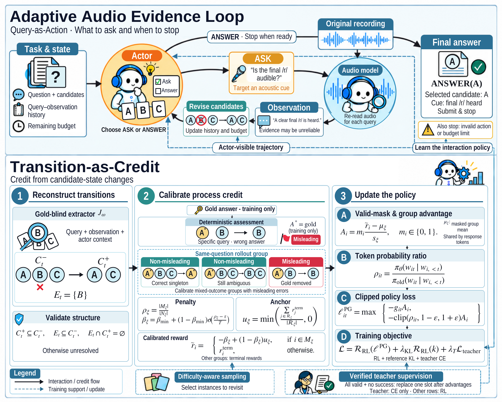

# Think2Listen: Evidence-Centric Learning for Agentic Audio Understanding with LALMs

## 📖 Introduction

Recent advances in large audio-language models (LALMs) have broadened audio understanding across speech, sound, and music, with tool-based agents further supporting these tasks by invoking predefined audio tools. However, a persistent gap remains between perceiving acoustic content and using it as evidence for reasoning: recognizing what is audible does not ensure that a model can identify which cues resolve an uncertain decision. To bridge this gap, we propose **`Think2Listen`**, an evidence-centric learning framework for agentic audio understanding. Guided by *evidence before commitment*, **`Think2Listen`** couples iterative reasoning with a targeted LALM interaction to actively seek acoustic cues that distinguish competing hypotheses and revise candidate judgments based on the observations returned. It learns *what to ask*, *how to use evidence*, and *when to stop*, using observation-induced changes in candidate-state to inform training credit. Extensive evaluations on two benchmarks spanning seven audio categories demonstrate that **`Think2Listen`** achieves **(I)** enhanced multi-step audio reasoning, with gains in overall accuracy of 5.08%--17.67% over competing audio agents; and **(II)** improved audio understanding and reasoning across speech, sound, and music, boosting overall accuracy by 2.29%--13.10% over the corresponding baselines.

<p align="center">
  
</p>

<p align="center"><em>Figure 1. Overview of the Think2Listen framework.</em></p>

## 📁 Project Structure

```text
Think2Listen/
├── assets/
│   └── main.png                          # Framework overview
├── configs/
│   ├── env.example                       # Runtime configuration template
│   └── eval.example.yaml                 # SLIME validation-data example
├── scripts/
│   ├── build_runtime_env.py              # Ray runtime environment builder
│   └── train.sh                           # SLIME training launcher
├── think2listen/
│   ├── prompts/                           # Model-facing prompts
│   ├── rollout/                           # ASK/ANSWER interaction and audio environment
│   ├── training/                          # Reward, data conversion, and joint loss
│   ├── transition_credit/                 # Transition reconstruction and calibration
│   └── teacher_trajectories/              # Verified teacher-bank utilities
├── main.py                                # Single-sample interaction entry point
└── README.md
```

## ⚙️ Training Environment

Training is built on slime framework. This repository provides the custom rollout, reward, data-conversion, and loss hooks used by SLIME and is loaded through `PYTHONPATH`; it does not require a standalone editable installation.

Required external components:

- compatible THUDM/slime and Megatron-LM checkouts;
- actor checkpoints in Hugging Face and distributed-training formats;
- an OpenAI-compatible audio-model endpoint;
- training and validation JSONL files;
- an extractor model when Transition-as-Credit is enabled;
- a verified teacher bank when teacher supervision is enabled.

The training launcher registers these hooks:

| Stage | Hook |
|---|---|
| Rollout | `think2listen.rollout.generator.custom_generate` |
| Terminal reward | `think2listen.training.reward.custom_rm` |
| Transition calibration | `think2listen.transition_credit.reward_postprocess.post_process` |
| Training-data conversion | `think2listen.training.data.convert_samples_to_train_data` |
| Joint policy/teacher loss | `think2listen.training.loss.joint_policy_teacher_loss` |

## 🚀 Usage

### 1. Configure paths and services

```bash
cp configs/env.example configs/env.local
# Replace every /path/to/... placeholder, then export the values in your shell.
```

### 2. Run one interaction

`main.py` runs the ASK/ANSWER interaction pipeline for one JSONL sample. It does not use the gold answer or compute aggregate evaluation metrics.

```bash
python main.py \
  --input /path/to/prompts.jsonl \
  --index 0
```

Add `--mock-audio` to inspect the control flow without requesting the audio model.

### 3. Launch training

```bash
bash scripts/train.sh
```

The launcher calls `${SLIME_DIR}/train.py`. It records the resolved command and Ray runtime environment in the run directory and refuses to overwrite an existing run or checkpoint directory.

## 🎛️ Method Switches

| Configuration | `ENABLE_TRANSITION_CREDIT` | `ENABLE_TEACHER_TRAJECTORIES` |
|---|:---:|:---:|
| Baseline GRPO | `0` | `0` |
| Transition-as-Credit | `1` | `0` |
| Verified teacher supervision | `0` | `1` |
| Full method | `1` | `1` |

## 📊 Data Interface

Each training JSONL row contains `prompt`, `label`, and a `metadata` object:

```json
{
  "prompt": "...",
  "label": "A",
  "metadata": {
    "sample_id": "example-0001",
    "question": "...",
    "choices": {"A": "...", "B": "...", "C": "..."},
    "correct_letter": "A",
    "initial_description": "...",
    "audio_path": "/path/to/audio.wav"
  }
}
```

Teacher-bank rows follow [`think2listen/teacher_trajectories/SCHEMA.md`](think2listen/teacher_trajectories/SCHEMA.md). Build a bank from successful verified rollouts with:

```bash
python -m think2listen.teacher_trajectories.build_bank \
  --input /path/to/verified-rollouts.jsonl \
  --output /path/to/teacher-bank.jsonl
```
